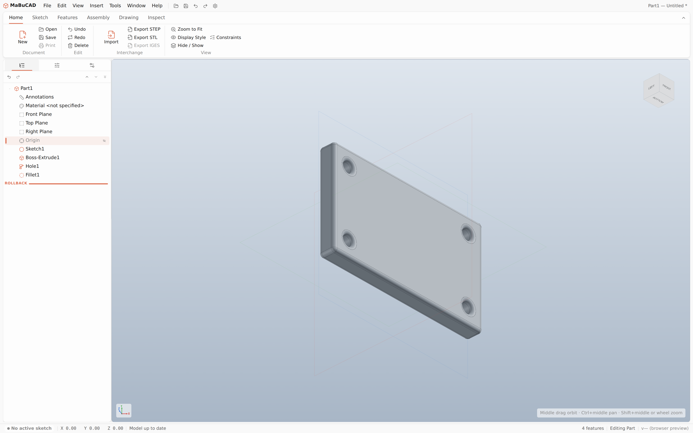

<div align="center">


# MaBuCAD

### Parametric 3D/2D CAD for the Windows desktop

History-based feature modelling, a constraint-driven 2D sketcher, and a real OpenCASCADE
B-Rep kernel — in the spirit of the mainstream CAD tools, running native on Windows 11 via
Tauri.

<br />

[](https://tauri.app)
[](https://react.dev)
[](https://www.typescriptlang.org)
[](https://threejs.org)
[](https://rustup.rs)
[](https://replicad.xyz)


<br />

[**Features**](#-features) &nbsp;•&nbsp;
[**Screenshot**](#-screenshot) &nbsp;•&nbsp;
[**Architecture**](#-architecture) &nbsp;•&nbsp;
[**Getting started**](#-getting-started) &nbsp;•&nbsp;
[**Formats**](#-supported-formats) &nbsp;•&nbsp;
[**Roadmap**](#-roadmap)

</div>

---

## ✨ Features

<table>
  <tr>
    <td width="33%" valign="top">

### 🧩 Parametric feature tree

Every feature (sketch, extrude, fillet, pattern…) is a step in an ordered, replayable
history — rollback, suppress, rename, reorder by dragging the rollback bar, undo/redo, all
live in the Feature Manager tree.

  </td>
  <td width="33%" valign="top">

### ✏️ Constraint-based sketcher

Line/rectangle/circle/arc/spline/construction/point, trim, fillet, offset, mirror,
linear/circular pattern, 10 geometric relations and smart/ordinate dimensioning, solved by a
damped-Newton solver that reports live degrees of freedom. Smart Dimension follows an
Inventor-style propose-then-commit flow, and dragging a point suggests
coincident/tangent/midpoint relations live ("constrains smart") — both shown as a preview
until you commit to them. Relations work select-then-apply or apply-then-select, either
order; a length dimension can be switched between Horizontal/Vertical/Aligned from its
right-click menu without re-adding it; and selected geometry gets a real halo highlight, not
just a colour swap.

  </td>
  <td width="33%" valign="top">

### 🧱 Real B-Rep kernel

Solids are genuine OpenCASCADE boundary representation, compiled to WebAssembly and driven
through [replicad](https://replicad.xyz) — not a triangle soup, which is what makes fillet,
shell and exact STEP export possible at all.

  </td>
  </tr>
  <tr>
    <td width="33%" valign="top">

### 🛠️ A full PartDesign set

Extrude/Cut, Revolve/Cut, Sweep/Cut (straight or spline path), Loft, a Hole Wizard driven by
real Autodesk clearance/tap-drill tables — Simple, Clearance, Tapped or Taper Tapped (NPT),
with a real Counterbore/Spotface/Countersink seat and an actual conical drill point on a
blind hole — Fillet, Chamfer, Shell, Draft, Rib, Linear/Circular Pattern, Mirror and
reference geometry.

  </td>
  <td width="33%" valign="top">

### 🎯 Edge-selective dress-up

Fillet and Chamfer default to every edge, or pick specific ones in the viewport — the picked
edge highlights as its own contour, not a marker dropped where you clicked — and picks are
re-resolved geometrically on every rebuild, an honest stand-in for persistent edge naming in
a kernel with none.

  </td>
  <td width="33%" valign="top">

### 🔄 STEP / STL interchange

STEP exports the kernel's own B-Rep (round-trips exactly); STL is a binary triangulation for
manufacturing hand-off. Both import back into the document as real features.

  </td>
  </tr>
  <tr>
    <td width="33%" valign="top">

### 🎨 Three skins, five accents

Light, Gray or Dark, each re-tinted live by any of five accent colours (or the original
Fluent blue) via `color-mix()`, plus Model Colour / Model Edge Colour overrides — all
gathered into their own Settings ▸ Colours tab.

  </td>
  <td width="33%" valign="top">

### 🪟 Windows 11 native

Tauri 2 shell with the real caption bar, Snap Layouts, per-monitor DPI and a translucent
Mica backdrop — Fluent 2 design tokens throughout, not an imitation.

  </td>
  <td width="33%" valign="top">

### 🧪 A real regression suite

60+ Playwright scripts drive the actual app end to end — sketch solving, every PartDesign
feature, undo/redo, import/export — not just typecheck and hope.

  </td>
  </tr>
  <tr>
    <td width="33%" valign="top">

### 🌍 9 languages

A language switcher for English, Slovak, Czech, German, French, Italian, Spanish, Russian
and Chinese. English and Slovak are fully translated today; the rest fall back to English
string-by-string until translated.

  </td>
  <td width="33%" valign="top">

### 🧭 Real 3D Navigation controls

Zoom-to-cursor, ViewCube visibility, origin indicator and XYZ axis labels — all genuinely
wired to the viewport, not decorative checkboxes.

  </td>
  <td width="33%" valign="top">

### 💾 Autosave & recovery

An opt-in `localStorage` recovery snapshot every 60s while there are unsaved changes, with
File ▸ Restore Autosave to bring it back — no native save dialog interrupting you.

  </td>
  </tr>
  <tr>
    <td width="33%" valign="top">

### ⌨️ Rebindable keyboard shortcuts

Esc/Del/Space and Undo/Redo work as bare-key shortcuts out of the box, with a Settings ▸
Shortcuts tab to rebind any of them by pressing a key.

  </td>
  <td width="33%" valign="top">

### 🖼️ Custom viewport backgrounds

Settings ▸ Colours ▸ Viewport Background: solid colour, a gradient from centre or bottom
with an intensity slider, or an uploaded image with its own opacity slider — on top of the
existing theme-matched default.

  </td>
  <td width="33%" valign="top">

### 🪲 Debug Mode

An opt-in diagnostic log (Settings ▸ General) that captures uncaught errors, unhandled
rejections, console warnings and rebuild failures to a plain-text file next to the
installed executable — attach it when reporting a problem.

  </td>
  </tr>
</table>

---

## 📸 Screenshot

<div align="center">



<sub>A mounting plate built from four features — a sketched profile, an extrude, a
Hole Wizard bolt pattern and a fillet — shown in the Feature Manager tree.</sub>

</div>

---

## 🏗️ Architecture

```
┌───────────────────────────────────────────────────────────┐
│ Tauri (Rust)      native window, Mica backdrop, scoped     │
│                   read/write file commands for interchange │
├───────────────────────────────────────────────────────────┤
│ React UI          ribbon, feature tree, property manager,  │
│   └── Zustand     sketch panel, status bar — one store per │
│                   concern (document, sketch, geometry,     │
│                   viewport, settings)                      │
├───────────────────────────────────────────────────────────┤
│ Viewport          react-three-fiber, frameloop="demand",   │
│                   CAD navigation (orbit/pan/zoom), a       │
│                   viewcube, B-Rep edge overlay drawn        │
│                   separately from the shaded triangulation │
├───────────────────────────────────────────────────────────┤
│ Sketch solver     damped Newton iteration over constraint  │
│                   + dimension residuals, finite-difference │
│                   Jacobian, DOF from its rank               │
├───────────────────────────────────────────────────────────┤
│ Geometric kernel  OpenCASCADE compiled to WASM (replicad), │
│                   lazy-loaded on first feature; the whole  │
│                   document rebuilds from feature history   │
│                   on every change, not incrementally       │
└───────────────────────────────────────────────────────────┘
```

<details>
<summary><b>🔍 Key engineering decisions</b></summary>

<br />

- **The whole document rebuilds from feature history on every change** — `kernel/rebuild.ts`
  replays every feature above the rollback bar into one solid, rather than patching an
  existing one. Simpler to reason about than incremental topological-naming updates, at the
  cost of rebuild time on very deep histories, which this project hasn't hit yet.
- **Sketches build in their own plane's local, un-rotated space**; only the final
  triangulated mesh gets a cosmetic display rotation for on-screen placement. The
  alternative — mapping this app's plane conventions onto the kernel's own — risks a
  mirrored axis silently flipping a part, so every sketch-based feature (extrude, revolve,
  fillet's edge picks, …) works in that same local space and only rotates for display.
- **Fillet and Chamfer can target specific edges with no persistent edge naming to lean
  on** — this kernel has none, since it rebuilds from scratch every time. A picked click is
  stored as a world-space point, converted into the kernel's own un-rotated solid space, and
  re-resolved on every rebuild via replicad's `EdgeFinder.withinDistance()`. Documented
  honestly as a geometric-proxy approximation, not true persistent naming: it can
  occasionally latch onto the wrong edge if the body changes drastically between picks.
  Picking against an already-rounded result would mean clicking edges that already moved, so
  entering pick mode previews the body as it was *before* the Fillet/Chamfer being edited.
- **A memory-corruption bug found and fixed in the vendored kernel**: STEP export goes
  through replicad's `shape.blobSTEP()` rather than its module-level `exportSTEP()`, and
  that choice is load-bearing. `exportSTEP()` builds a throwaway XCAF document and cleans up
  two internally-linked OpenCascade objects through independent `FinalizationRegistry`
  callbacks the JS engine runs at a time of its own choosing — when both eventually fire,
  they can free the same underlying object twice, corrupting the WASM heap silently. Caught
  by forcing V8's GC after a single export and watching the *next*, unrelated kernel call
  throw. `blobSTEP()` deletes everything it touches synchronously before returning, the same
  pattern replicad's own import functions already use safely — verified stable under the
  identical stress test that broke `exportSTEP()`.
- **`raycast={undefined}` is not "leave it alone"**: react-three-fiber still assigns
  `instance.raycast = undefined` as an own property on the underlying `three.js` object,
  which shadows `LineSegments.prototype.raycast` — the real hit-testing implementation — on
  the prototype chain, silently breaking every click against it with no console error. Found
  while wiring up edge picking (the edge overlay used this pattern to opt out of raycasting
  when not needed); fixed by passing the real prototype method instead of `undefined`.
- **A `frameloop="demand"` canvas can miss the very first click after a tool switch**: r3f's
  pointer raycasting reads matrices from the last *rendered* frame, and nothing was asking
  for a fresh one at the moment a tool changed — if a click's pointerdown/up landed before
  the browser's next paint, it could raycast against stale state and hit nothing. This
  root-caused what had looked all session like sporadic sketch-tool test flakiness; the fix
  (an explicit `invalidate()` on tool change) narrows the window without fully closing it —
  a real user's natural reaction time practically never triggers it, but a scripted client
  clicking with zero gap still can, rarely.
- **The accent colour is one CSS custom property, not a colour per component**: `tokens.css`
  derives every hover/active/subtle/selection/text shade from a single `--accent-hex` via
  `color-mix()`, so a Settings swatch re-tints the whole app in one write. Scene colours
  (sketch previews, selection highlights) can't read a CSS variable — `three.js` materials
  need an actual value — so `useSceneAccentColor()` mirrors the same derivation in
  JavaScript for the viewport.
- **Fluent-only where it doesn't cost correctness**: the window keeps its native Windows
  caption bar (`decorations: true`) rather than a custom-drawn one, so Snap Layouts, rounded
  corners and per-monitor DPI come from the OS. Mica needs `transparent: true`, so the page
  background is transparent inside Tauri and opaque in a plain browser, switched by a
  `data-tauri` attribute `main.tsx` sets once at startup.

</details>

<details>
<summary><b>🧰 Tech stack</b></summary>

<br />

| Layer | Technology |
| --- | --- |
| Desktop shell | Tauri 2 (Rust) — native window, file access, MSI/NSIS packaging |
| Frontend | React 19 + TypeScript, built with Vite 7 |
| Styling | CSS custom properties and CSS Modules, following Windows 11 Fluent 2 |
| State | Zustand — one store per concern (document, sketch, geometry, viewport, settings) |
| Viewport | Three.js 0.185 via react-three-fiber 9 and drei 10 |
| Geometric kernel | OpenCASCADE (WebAssembly) via replicad |

</details>

---

## 🚀 Getting started

> [!IMPORTANT]
> **Prerequisites (Windows 11 x64):** [Visual Studio 2022 Build Tools](https://visualstudio.microsoft.com/downloads/)
> with the *Desktop development with C++* workload, [Rust](https://rustup.rs)
> (`stable-x86_64-pc-windows-msvc`), and **Node.js 20+**. The WebView2 runtime ships with
> Windows 11 already. Full details: <https://v2.tauri.app/start/prerequisites/>.

```powershell
npm install
npm run tauri dev      # desktop app with hot reload

# …or run the browser-only dev server (native dialogs replaced by browser fallbacks)
npm run dev             # http://localhost:1420
```

<details>
<summary><b>✅ Quality gates</b></summary>

<br />

```powershell
npm run typecheck      # tsc --noEmit
npm run build           # typecheck + production frontend build
npm run tauri build    # MSI and NSIS installers in src-tauri/target/release/bundle/
```

`scripts\build-msi.ps1` wraps install + typecheck + `tauri build` into one command:

```powershell
.\scripts\build-msi.ps1                          # full build
.\scripts\build-msi.ps1 -SkipChecks -SkipInstall  # fastest rebuild once deps/types are known-good
.\scripts\build-msi.ps1 -Target msi -Open         # just the MSI, then open the output folder
```

</details>

<details>
<summary><b>🧪 Regression testing</b></summary>

<br />

A large committed suite of Playwright scripts drives the real dev server end to end —
sketch drawing and the constraint solver, every PartDesign feature, undo/redo/rollback,
import/export round trips, theming, and the full ribbon command surface — rather than
relying on typecheck and build alone to say a feature actually works. See
[`CHANGELOG.md`](./CHANGELOG.md) for the dated history of what was verified, and the bugs
this suite caught along the way (including a WASM heap-corruption bug in the vendored
kernel, a rare pointer-event race in the sketch tool, and a UI panel that silently never
surfaced a new Fillet/Chamfer's own edge-selection and radius controls).

</details>

---

## 📂 Project layout

```
src/
  commands/ribbonConfig.ts   Declarative ribbon: tabs, groups and commands
  commands/commandRegistry.ts  Maps ribbon command ids to store actions
  commands/interchange.ts    Export/import commands, reported through a status toast
  components/
    layout/                  AppShell — the four-row application grid
    menubar/                 Menu strip and quick access toolbar
    ribbon/                  Command manager rendered from ribbonConfig
    manager/                 Left dock hosting Feature/Property/Configuration tabs
    tree/                    Feature manager design tree
    property/                Context-sensitive property manager and sketch panel
    settings/                Application Options dialog (theme, accent, units, tolerances)
    viewport/                Graphics area: canvas, scene contents and CAD navigation
    statusbar/               Sketch status, cursor readout, unit system
  kernel/occ.ts               Lazy OpenCASCADE WebAssembly boot
  kernel/profile.ts           Closed-loop extraction from a sketch
  kernel/rebuild.ts           Feature history -> solid -> triangulated mesh
  kernel/io.ts                 STEP/STL export and import against the kernel
  sketch/solver.ts             Damped Newton constraint solver and DOF counting
  sketch/residuals.ts          Constraint and dimension residual equations
  sketch/sketchModel.ts        Sketch construction, snapping and measuring
  sketch/planeBasis.ts         Sketch 2D <-> world transforms
  state/documentStore.ts       Feature history, selection, undo/redo
  state/sketchStore.ts         Active sketch, tools, selection and solving
  state/geometryStore.ts       Rebuilt mesh, rebuild status, transient toast
  state/settingsStore.ts       Theme, accent colour, tolerances — persisted to localStorage
  state/featureCatalog.ts      Per-kind naming, icons and default parameters
  hooks/                       Tauri app info, theme + accent colour resolution
  styles/tokens.css            Fluent design tokens, theme skins, accent derivation
  types/document.ts            Feature and document model
src-tauri/
  src/lib.rs                   Tauri builder, plugin and command registration
  src/fileio.rs                 Scoped read/write commands for interchange
  tauri.conf.json               Window, Mica effect, CSP and bundle configuration
scripts/build-msi.ps1          Wraps install + typecheck + `tauri build` into one command
```

---

## 💾 Supported formats

| Format | Import | Export | Notes |
| :---: | :---: | :---: | --- |
| **STEP** | ✅ | ✅ | Exact B-Rep (`ADVANCED_BREP`), round-trips exactly |
| **STL** | ✅ binary | ✅ binary | Triangulated mesh, for manufacturing hand-off / 3D printing |
| **IGES** | — | — | The bundled OpenCASCADE build has no IGES support compiled in; the ribbon button stays visibly present but disabled, with the reason in its tooltip |
| **`.mabucad`** (document) | ✅ | ✅ | The full parametric feature history, sketches included |
| **`.mabucad-settings`** | ✅ | ✅ | App-wide preferences (theme, accent, tolerances) — for backup or a second machine |

---

## 🗺️ Roadmap

| Area | Scope | Status |
| --- | --- | :---: |
| Project shell | Tauri + React + Vite scaffolding, Fluent 2 UI chrome | ✅ |
| Viewport | CAD navigation, reference planes, origin, viewcube, axis-cross legend | ✅ |
| Document model | Feature tree, rollback, suppress, undo/redo, rename, drag-reorder | ✅ |
| Sketcher | Full entity set, 10 relations, dimensioning, damped-Newton solver | ✅ |
| Core solids | Extrude/Cut-Extrude, Revolve/Cut-Revolve | ✅ |
| Import/Export | STEP (exact B-Rep) and STL, native + browser-fallback dialogs | ✅ |
| Sketch tools | Trim (lines, circles, splines, drag-to-window multi-select), Fillet, Offset, Mirror, Linear/Circular Pattern | ✅ |
| Reference geometry | Plane, Axis, Point, Coordinate System, with a 3D presence | ✅ |
| Hole Wizard | Simple/Clearance/Tapped/Taper Tapped, real ISO clearance and tap-drill data, Counterbore/Spotface/Countersink seats, conical drill point | ✅ |
| Dress-up | Fillet, Chamfer, Shell, Draft, Rib — with edge-selective Fillet/Chamfer | ✅ |
| Advanced solids | Sweep/Cut-Sweep (straight and spline paths), Loft | ✅ |
| Pattern/Mirror (feature-level) | Linear Pattern, Circular Pattern, Mirror | ✅ |
| Theming | Light/Gray/Dark skins, 5 live accent colours, Model/Edge colour overrides | ✅ |
| 3D Navigation | Zoom-to-cursor, ViewCube toggle + navigation arrows, origin indicator + axis labels | ✅ |
| Autosave | Opt-in periodic recovery snapshot, restorable from the File menu | ✅ |
| New Document picker | Visual Part/Assembly/Drawing chooser (Part wired, rest "coming soon") | ✅ |
| Localisation | 9-language switcher; English and Slovak fully translated | 🟡 |
| Boundary surface | Guide-curve boundary blending | ⬜ |
| Assembly | Components, mates, exploded views | ⬜ |
| Drawing | 2D sheets, projected/section/detail views, annotations, BOM | ⬜ |
| Inspect | Measure, Mass Properties, Section Properties, Check Geometry, Draft Analysis, Parent/Child, Equations, Sensors, Appearance; Curvature dropped (no kernel support) | ✅ |

<sub>✅ done &nbsp;•&nbsp; 🟡 partial &nbsp;•&nbsp; ⬜ planned — see
[`CHANGELOG.md`](./CHANGELOG.md) for the full dated history, including bugs found and fixed
along the way.</sub>

---

<div align="center">


**MaBuCAD** — built with Tauri, React, TypeScript, Three.js and OpenCASCADE.

<sub>Made for Windows 11 • Fluent 2 design • Real B-Rep, not a triangle soup</sub>

</div>
